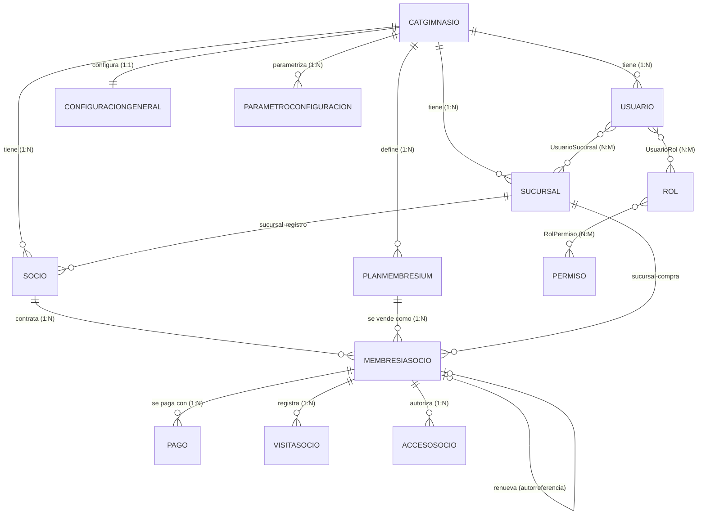

# 🧱 Núcleo ERP inmutable del dominio

> **Regla**: estas tablas y sus campos base son la identidad del sistema. No se renombran, no se eliminan, no cambian de tipo. Toda necesidad nueva se resuelve con los mecanismos de [`02-extension-por-gimnasio.md`](02-extension-por-gimnasio.md). Cambiar el núcleo requiere ADR + aprobación del dueño.

## Por qué "inmutable"

Un gimnasio de otro local puede necesitar más reglas, más campos o más lógicas. Si cada necesidad modifica las tablas base, el sistema se degrada con cada cliente. El núcleo inmutable garantiza que **cualquier gimnasio funcione con el mismo corazón**, y las diferencias se manejan por configuración y extensión.

## Entidades del núcleo MVP

### Tenancy
| Tabla | Campos clave | Rol |
|---|---|---|
| `CatGimnasio` | `GimnasioId PK`, `Nombre`, `Codigo`, `Activo`, `Version` | Raíz del tenant. `Codigo` debe ser único (identificador de gimnasio) |
| `Sucursal` | `SucursalId PK`, `GimnasioId FK` | Locales de un gimnasio |

### Seguridad
| Tabla | Campos clave | Rol |
|---|---|---|
| `Usuario` | `UsuarioId PK`, `GimnasioId FK`, `Correo`, `PasswordHash`, `TipoAutenticacion`, `Activo` | Acceso al sistema (por gimnasio) |
| `Rol`, `Permiso`, `RolPermiso`, `UsuarioRol` | — | RBAC clásico N—N |
| `UsuarioSucursal` | — | Asignación de usuarios a sucursales |

### Socios
| Tabla | Campos clave | Rol |
|---|---|---|
| `Socio` | `SocioId PK`, `GimnasioId FK`, `SucursalRegistroId FK`, datos personales, contacto de emergencia | El cliente del gimnasio |
| `VisitaSocio`, `AccesoSocio` | fechas, membresía ref. | Historial de visitas y control de acceso |

### Membresías y dinero
| Tabla | Campos clave | Rol |
|---|---|---|
| `PlanMembresium` | `PlanMembresiaId PK`, `GimnasioId FK`, nombre, precio, duración | Catálogo de planes |
| `MembresiaSocio` | `MembresiaSocioId PK`, `SocioId FK`, `PlanMembresiaId FK`, `FechaInicio/Fin`, `PrecioContratado`, `Estado`, `MembresiaAnteriorId` (autorreferencia → renovaciones) | Contratación y vigencia |
| `MetodoPago`, `Pago` | montos, referencia | Cobros |
| `SaldoSocio` | — | Saldo a favor / deuda |

### Configuración (escudo de inmutabilidad)
| Tabla | Campos clave | Rol |
|---|---|---|
| `ConfiguracionGeneral` | 1—1 con gimnasio: moneda, país, idioma, zona horaria, toggles (`PermitirAccesoSocios`, `PermitirReservaciones`, `PermitirVentaSinSocio`, `PermitirSaldoAfavor`…) | Comportamiento por gimnasio sin tocar el núcleo |
| `ParametroConfiguracion` | `Clave`, `Valor`, `TipoDato` por gimnasio | Reglas configurables clave-valor |

## Relaciones y cardinalidad (núcleo)

**Cardinalidades que hay que validar en BD** (índices/constraints recomendados):

- `CatGimnasio.Codigo` → **único**
- `Usuario.Correo` → único **por gimnasio** (`IX (GimnasioId, Correo)`)
- `MembresiaSocio` activa por socio → única (`IX (SocioId) WHERE Activo = 1`)
- Todo índice de tabla de negocio debe **iniciar por `GimnasioId`**

## Reglas de negocio del núcleo (inmutables)

1. Ninguna fila existe sin `GimnasioId` válido.
2. Una membresía no puede empezar antes de terminar la anterior (se encadenan por `MembresiaAnteriorId`).
3. El dinero solo se mueve con `MetodoPago` registrado y genera `MovimientoCaja`/`Pago` trazable.
4. `Version` (rowversion) protege toda actualización concurrente.
5. Borrado lógico (`Activo = 0`); nunca `DELETE` físico en tablas del núcleo.
